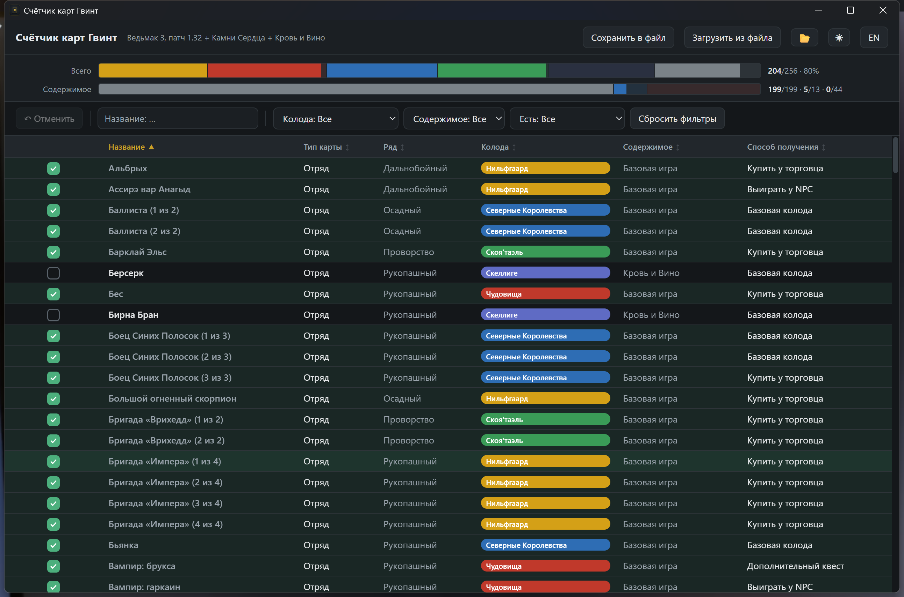
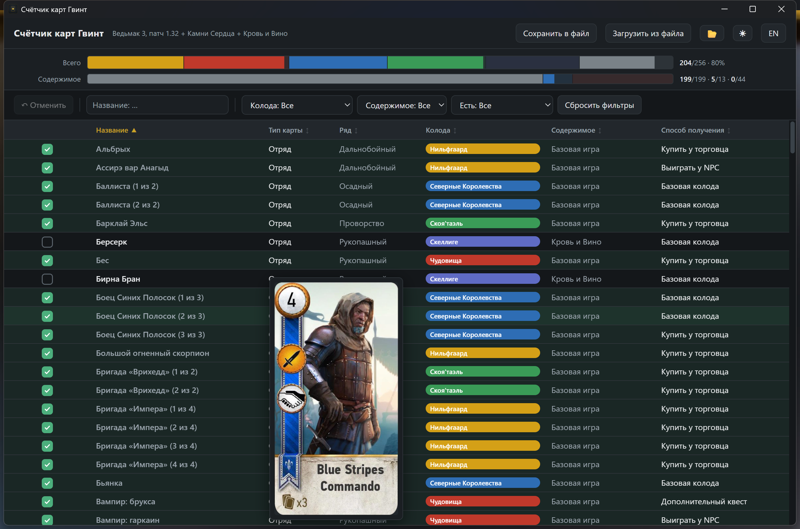
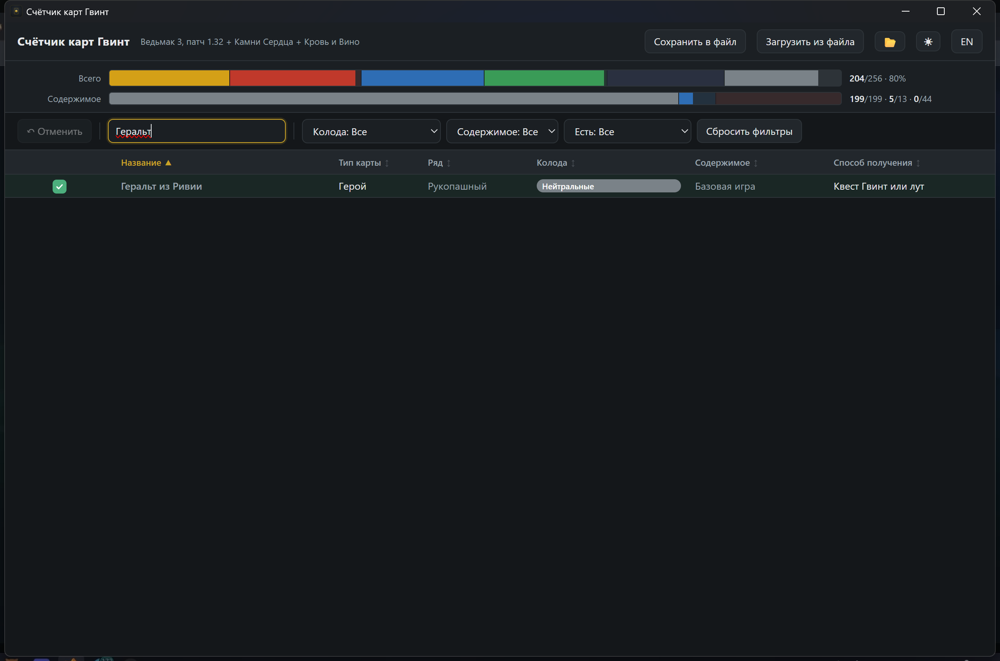

# Счётчик карт Гвинт

   

Небольшое настольное приложение, которое помогает **собрать все карты Гвинта** в The Witcher 3 (патч 1.32 + «Камни Сердца» + «Кровь и Вино»): **256 карт, 182 уникальных**, шесть колод. Вы отмечаете собранное — программа считает прогресс и подсказывает, где искать остальное.

---

## Скриншоты



<p align="center"><i>Шкалы прогресса, фильтры и таблица карт</i></p>



<p align="center"><i>Наведите курсор на название — увидите изображение карты</i></p>



<p align="center"><i>Поиск по имени срабатывает мгновенно</i></p>

## Зачем это нужно

В игре нет единого списка карт с отметками — Геральт вынужден помнить наизусть, у кого из ~50 торговцев и в каких локациях ещё не куплены карты. Это приложение заменяет самоклейки и тетрадку:

- **Видно, что осталось.** Чекбокс напротив каждой карты; несобранные всегда на виду.
- **Видно, где взять.** Для каждой карты указан способ получения (у кого купить, где добыть) и локация.
- **Прогресс не даёт потеряться.** Полосы: общий счёт и разбивка по источникам (базовая игра, оба дополнения). Всё считается само — каждая отметка двигает шкалы на глазах.
- **Данные не пропадут.** Отметки сохраняются сами и переживают переустановку игры и перенос exe.

## Возможности

| Функция | Что это даёт |
|---|---|
| Чекбоксы и клик по строке | Мгновенная отметка «собрано» |
| Прогресс-шкалы | Общий счёт + разбивка по колодам (цвета колод) и по содержимому |
| Фильтры | Поиск по названию, селекты колоды / содержимого / «есть–нет» |
| Сортировка колонок | Клик по заголовку столбца, повторный клик — в обратную сторону |
| Картинки карт | Наведите курсор на название — появится изображение карты |
| Отмена | До 30 шагов undo после любых отметок |
| Экспорт / импорт JSON | Перенос прогресса на другой компьютер, резервная копия |
| Тёмная / светлая тема, RU / EN | Переключение кнопками в шапке |
| Автосохранение | Каждое действие сразу пишется на диск |

## Установка

### Способ 1 — готовый exe (для любого пользователя)

1. Получите файл **`gwent-cards.exe`** (из релиза репозитория или от автора проекта).
2. Положите его в любую папку, например `C:\Programs\GwentCards\` — установка не требуется.
3. Запустите двойным кликом. Всё.

- Размер — один файл ~18 МБ, права администратора не нужны.
- Требуется лишь WebView2 (уже предустановлен в актуальных Windows 10/11). Если приложение не запускается — поставьте [WebView2 Runtime](https://developer.microsoft.com/microsoft-edge/webview2/).

### Способ 2 — сборка из исходников

Нужны Node.js 18+, Rust (toolchain `msvc`) и MSVC Build Tools с компонентом «Разработка классических приложений на C++».

```bat
cd D:\GwentCards
build-app.cmd
```

Готовый exe появится в `src-tauri\target\release\gwent-cards.exe`. Внутри `build-app.cmd` пути настроены под конкретную машину (Rust на `D:\Rust`, MSVC ищется автоматически через `vswhere`); на другой машине правьте переменные в начале PowerShell-части `build-app.ps1` или запускайте напрямую:

```bat
npm install
npm run tauri build -- --no-bundle
```

## Где хранятся данные

| Что | Где |
|---|---|
| Прогресс (`progress.json`) | `%APPDATA%\local.gwent.cards\` — переживает переустановку и перенос exe |
| Экспорт файлов JSON | Кнопки «Сохранить в файл» / «Загрузить из файла» в шапке |
| Папка данных | Кнопка 📂 открывает её в Проводнике |

## Источник данных

Названия, описания и изображения карт взяты с [Witcher Wiki](https://witcher.fandom.com) и [Вики Ведьмака](https://vedmak.fandom.com) (**CC BY-SA**); указание авторства сохранено в поле `meta.source` файла `src/data/cards.json`. Код приложения написан с нуля.
